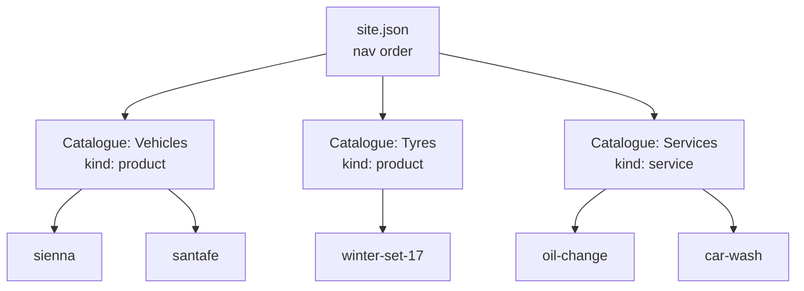
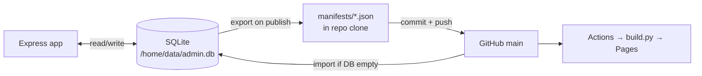
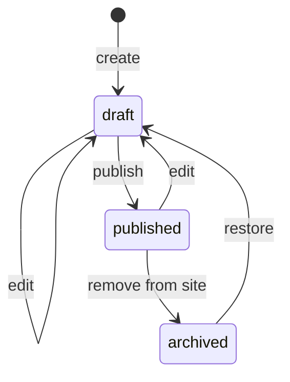
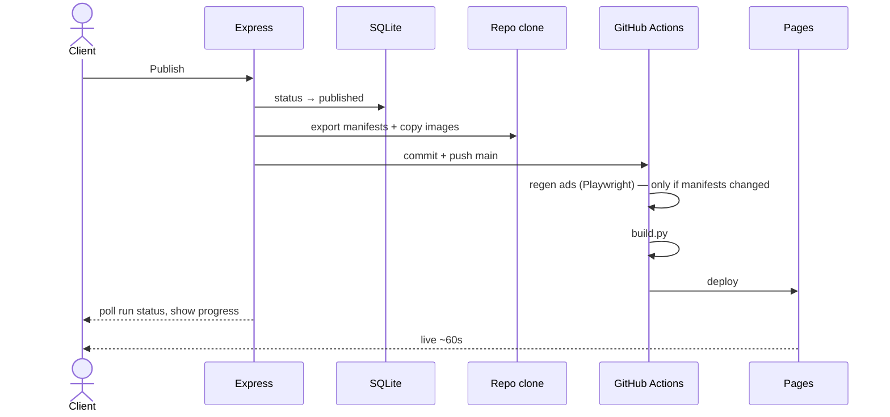
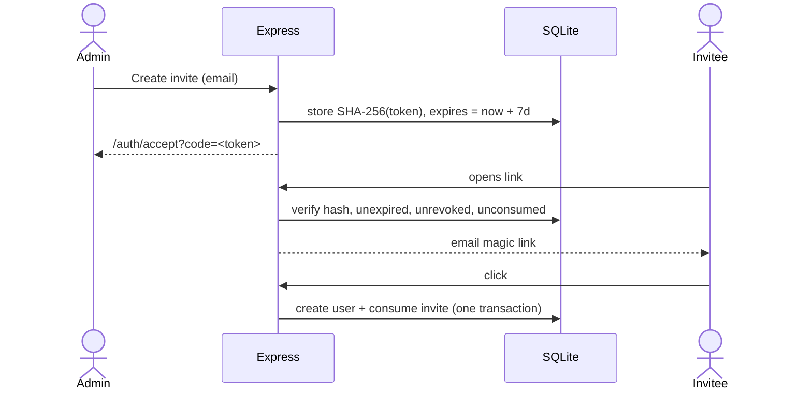
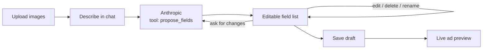
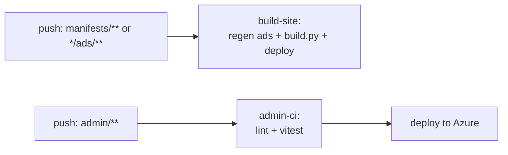

# Admin app — implementation plan (v2)

> **See also [`AGENT_ADMIN_PLAN.md`](AGENT_ADMIN_PLAN.md)** — agent-driven alternatives
> that need no hosting and no auth system. The Express app here is now the fallback,
> not the baseline.

Status: **proposal, nothing built.** Revised 18 Oct 2026 after your answers.
Supersedes `ADMIN_PLATFORM_PLAN.md`.

Prototype screens: [`docs/prototype/`](prototype/) — open `index.html` in a browser.
They are self-contained (Bootstrap vendored in `prototype/vendor/`); the only external
requests are Google Fonts and the live ad images.

---

## 1. Decisions locked in

| Question | Your answer | Consequence |
|---|---|---|
| Services | Same design, no deviation | One ad template, generic spec slots |
| Catalogues | Multiple; cars is just the first | Catalogue is a first-class object |
| Workflow | draft → published | No review state |
| Roles | One admin, full CRUD | No role table, no permission checks |
| Language | Modern JS, not TS | ESM + Zod for runtime validation |
| Fields | Dynamic per catalogue | Spec slots with catalogue defaults |
| Store | SQLite | SQLite working store, git durable (§4) |
| Auth | Magic link | Confirmed |

---

## 2. Hosting — GitHub Pages is not an option

Pages serves static files from a CDN. It runs no processes, so it cannot host Express.
There is no setting that changes this. Checked your two fallbacks:

- **Heroku free tier was removed in November 2022** and has not returned. Cheapest is
  now an Eco dyno at ~$5/mo.
- **Azure App Service F1 (Free) works**, and since you already have the subscription,
  it is the pick.

### Azure F1 caveats, stated plainly

| Limit | Effect here |
|---|---|
| 60 CPU-minutes/day | Fine. An admin used in short bursts will not approach this. |
| No Always On; sleeps when idle | First request after a nap takes ~10–20s. Acceptable for an admin, unacceptable for a storefront — which is exactly why the public site stays on Pages. |
| 1 GB storage | Fine. The repo clone + SQLite is tens of MB. |
| No custom domain on F1 | You get `yourapp.azurewebsites.net`. You said domain can wait. |
| `/home` is SMB-backed | **This is the one that matters** — see §4. |

```
yourapp.azurewebsites.net   →  Express admin      (Azure App Service F1, Linux, Node 22)
cloudstrucc.github.io/…     →  static storefront  (GitHub Pages, unchanged)
```

If F1's cold starts annoy you later, B1 is ~$13/mo and adds Always On. Don't pay until
it actually irritates you.

---

## 3. Catalogues are the core abstraction

Your "multiple catalogues" answer is the biggest change from v1. Cars stop being special:



A catalogue owns: its nav label and order, its landing copy, and — critically — **the
default field labels its items use.** Each catalogue generates exactly the structure the
site has today: a landing board plus a child page per item.

### Dynamic fields, concretely

The ad has **three spec slots**. A catalogue supplies default labels; an item may
rename, re-value, or clear any slot. That is your tag idea with a fixed ceiling, so the
ad layout never breaks:

| Catalogue | Slot 1 | Slot 2 | Slot 3 |
|---|---|---|---|
| Vehicles | KM · 107,000 | Engine · 2.4L I4 | Drivetrain · FWD/AWD |
| Tyres | Size · 225/60R17 | Season · Winter | Condition · 80% tread |
| Services | Duration · 45 min | Includes · Wash + wax | Warranty · 30 days |

Fields the client never sees are absent, not blank. A car wash is never asked for
mileage, because its catalogue does not define that slot.

> **Why three and not unlimited:** the Velocity ad draws three columns between two rules.
> A fourth needs a redesign of the artwork. Keeping the ceiling at three is what lets
> "no deviation from the current design" and "dynamic fields" both be true. Items may
> carry extra fields for the *page* — just not for the *ad*.

---

## 4. Storage — SQLite, with git as the durable copy

You chose SQLite. Taking Azure F1 into account changes *where* it lives.

**The problem:** App Service `/home` is an SMB network share, and F1 apps sleep and
restart frequently. SQLite over SMB with unclean shutdowns is the classic corruption
scenario. Putting the only copy of your content there would be a mistake.

**The design:**



- **SQLite is the working store.** Queries, drafts, sorting, the editor — all SQLite.
- **Publishing exports JSON manifests** into the repo and commits them.
- **The repo is the durable copy.** If the DB is lost or corrupted, the app re-imports
  from `manifests/` on boot. Losing the volume costs you unpublished drafts, nothing more.
- **`build.py` keeps reading JSON**, so it stays stdlib-only and CI needs no database.

This gives you SQLite where it helps and diffable, reviewable, revertable history where
*that* helps. You also get a free content backup on every publish.

### Auth data stays out of the repo

This repo is **public** (verified). Users, invite tokens and sessions live only in
`/home/data/admin.db`, gitignored and never exported. If that volume is lost, recovery
is `npm run admin:create` over SSH plus re-issuing one invite — annoying, not fatal.

### Tables

```sql
catalogues (id, slug, kind, nav_label, nav_order, heading, lede, status, spec_defaults_json)
items      (id, catalogue_id, slug, status, order_index, title, subtitle, year, price,
            eyebrow, body, specs_json, created_at, updated_at, published_at)
images     (id, item_id, filename, role, width, height, bytes, created_at)
users      (id, email, name, created_at, last_login_at)
invites    (id, token_hash, email, created_by, expires_at, revoked_at, consumed_at)
sessions   (sid, sess, expire)
```

Seven tables, `better-sqlite3`, handwritten SQL. No ORM, no migration framework at this
size — a numbered `migrations/*.sql` folder applied on boot is enough.

### Exported manifest shape

```jsonc
// manifests/catalogues/vehicles.json
{
  "schema": 1, "slug": "vehicles", "kind": "product", "status": "published",
  "nav_label": "Vehicles", "nav_order": 1,
  "heading": "The Lineup",
  "lede": "Pre-owned vehicles for Ottawa drivers, priced to move…",
  "spec_defaults": [
    { "label": "KM" }, { "label": "Engine" }, { "label": "Drivetrain" }
  ]
}

// manifests/items/vehicles/santafe.json
{
  "schema": 1, "slug": "santafe", "catalogue": "vehicles",
  "status": "published", "order": 1,
  "title": "Hyundai Santa Fe Sport", "subtitle": "2.4L · Heated Seats",
  "year": "2017", "price": "14,000", "eyebrow": "Certified",
  "specs": [
    { "label": "KM",         "value": "107,000" },
    { "label": "Engine",     "value": "2.4L I4" },
    { "label": "Drivetrain", "value": "FWD/AWD" }
  ],
  "images": [{ "file": "santafe_a.jpg", "role": "primary" }],
  "audit": { "updated_by": "client@…", "published_at": "2026-10-18T…" }
}
```

Every write — manual, imported, or AI-proposed — is validated by the same Zod schema
before it reaches SQLite or disk.

---

## 5. State machine



- Drafts live only in SQLite — **never pushed**, so nothing unfinished can reach the site.
- `published → draft` keeps the live version serving until the draft is published.
- Only publish/archive/restore produce commits.
- A published item requires ≥1 image and all its catalogue's slots filled. Enforced in
  the schema, so the client cannot publish something that renders broken.

---

## 6. Publish pipeline



The admin host needs no Python and no Chromium — ad rendering happens in Actions via the
existing `tools/regen.sh`. That is what keeps the Node app genuinely lean.

**Show the Actions run status in the UI.** A minute of silence after clicking Publish
reads as broken to a non-technical user.

---

## 7. Auth

Passport + `passport-magic-link`, invite-only, one role.



- 32 random bytes, base64url; only the hash stored
- 7-day expiry; Revoke sets `revoked_at`; both checked at redeem
- Code prefilled from `?code=`, manually enterable as fallback
- `Referrer-Policy: no-referrer` on `/auth/*` — URL tokens leak via referrer
- `express-rate-limit` on redeem and sign-in
- First admin: `npm run admin:create -- fred@…`

---

## 8. Editor and chat



The model gets **one tool**, `propose_fields`, whose arguments are the item schema for
*that catalogue* — so it cannot invent a Drivetrain field for a car wash. Output is
Zod-validated and rejected on failure. It never writes files; it only fills a form the
client is already reviewing.

**Build the plain form first (Phase 3), add chat in Phase 5.** For eight fields, typing
is often faster than describing and correcting. Chat earns its place on bulk paste —
drop in a Kijiji listing, get fields — so that is the case to design for.

Cost control: max tokens per call, max calls per draft, monthly ceiling. Key is
server-side only.

---

## 9. Theme

**Tabler** (MIT, Bootstrap 5). Cleanest of the free admin themes, best component set.
AdminLTE 4 is the safe alternative if you want the larger community; CoreUI Free is a
fine middle ground. You need about six screens — pick on looks and move on.

The prototypes in `docs/prototype/` use plain Bootstrap 5.3.3 so each file stands alone
with no build step. The real app would pull Tabler proper.

Admin stays Bootstrap; the public site keeps its bespoke Velocity CSS. Different
products, different jobs.

---

## 10. Libraries

| Concern | Choice |
|---|---|
| Server / views | `express` 5, `express-handlebars` |
| Islands | `svelte` 5 + `vite` (editor, chat, preview only) |
| Auth | `passport`, `passport-magic-link`, `express-session`, `connect-sqlite3` |
| DB | `better-sqlite3` |
| Validation | `zod` |
| Git | `simple-git` |
| Uploads | `multer`, `sharp` (resize, strip EXIF) |
| AI | `@anthropic-ai/sdk` |
| Email | `resend` |
| Security | `helmet`, `express-rate-limit`, `csurf` |
| Logging / tests | `pino`, `vitest`, `supertest` |

Plain ESM JavaScript as you prefer. Zod still carries the schema, which is where type
safety actually matters here — it validates at runtime, which TypeScript would not.

---

## 11. Repo layout

```
/                    static site (unchanged)
  build.py           extended: generates a landing per catalogue
  tools/             extended: gen_velocity reads manifests
  manifests/         NEW — exported content, committed
    catalogues/*.json
    items/<catalogue>/*.json
  admin/             NEW — Express app
    src/{routes,services,islands,views}
    migrations/*.sql
    data/            SQLite — gitignored
  docs/prototype/    NEW — these mockups
```

---

## 12. Automation



Path filters so an admin code change does not re-render 15 ads. Cache the Playwright
browser in Actions or every publish pays ~45s. Deploy to Azure via publish profile in
GitHub secrets.

---

## 13. Phasing

| Phase | Scope | Effort |
|---|---|---|
| **0** | `gen_velocity.py` reads manifests; export today's 5 cars; byte-identical output | 3–4 days |
| **1** | `build.py` generates a landing per catalogue from manifests | 3–4 days |
| **2** | Express + Tabler + magic-link auth + invites + SQLite | 1 week |
| **3** | Catalogue & item CRUD, uploads, **plain form**, draft state | 1.5 weeks |
| **4** | Publish: export → commit → push → Actions status in UI | 4–5 days |
| **5** | AI chat + live preview | 1 week |

**~5 weeks.** Usable after Phase 4; Phase 5 is the differentiator, not the foundation.

Phase 0 is the one to resist skipping. Until the generator reads manifests, the admin
writes JSON that nothing consumes.

---

## 14. Remaining pushback

1. **Phase 0 + 1 are half the project and produce no visible UI.** Generalising a
   hardcoded, car-shaped Python renderer to arbitrary catalogues is where the risk sits.

2. **Three spec slots is a real ceiling.** It is what makes "don't deviate from the
   design" compatible with "dynamic fields". A catalogue needing five ad fields means
   redrawing the artwork.

3. **~60s publish latency** is inherent to rebuilding a static site. Surface the
   progress or it reads as broken.

4. **F1 cold starts** mean the client occasionally waits ~15s for the login page. Tell
   them, or pay for B1.

5. **Single writer.** Two people publishing simultaneously is a push conflict. Fine at
   one or two users; mitigate with a lock and pull-before-write; know the ceiling exists.

6. **A services catalogue will strain the car-shaped ad.** "Oil change" has no photo of
   a product the way a car does. Expect the artwork to want stock imagery or an icon
   treatment — worth a design decision before Phase 1.
