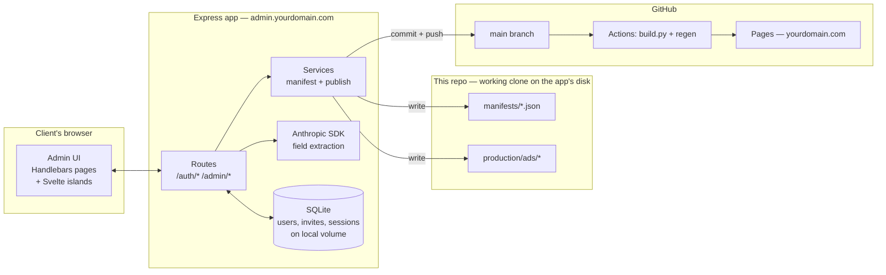
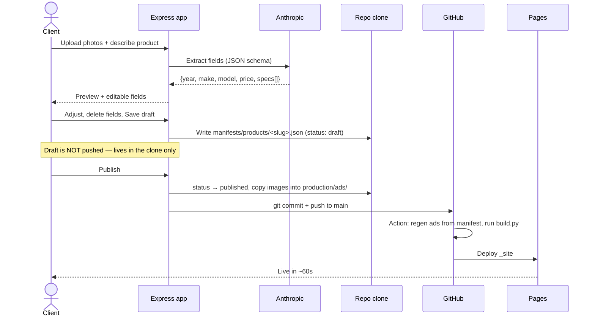
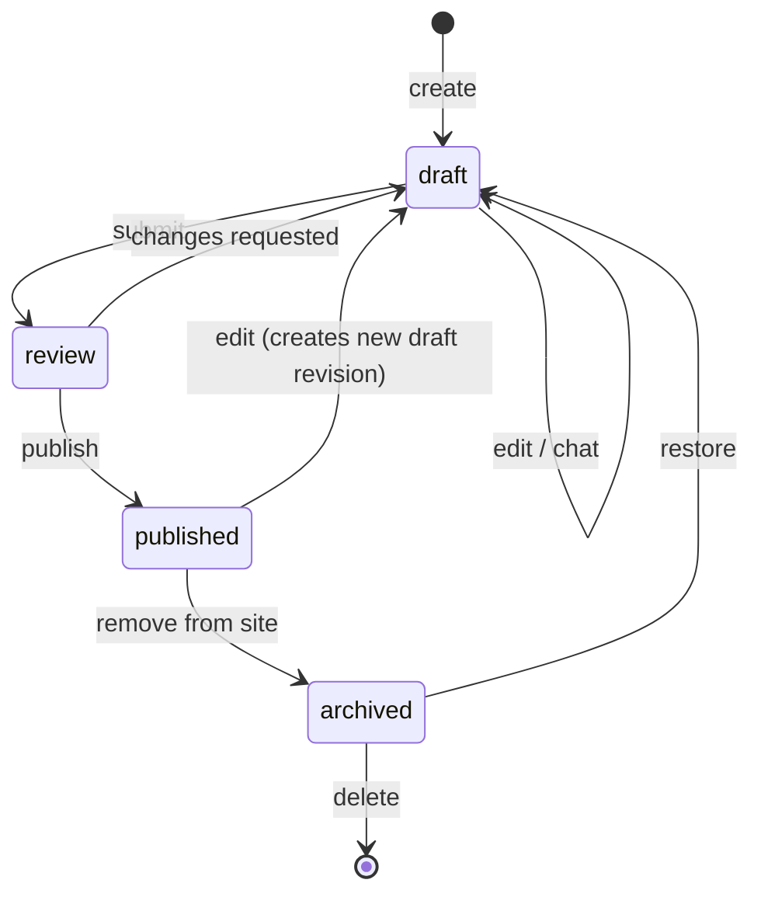
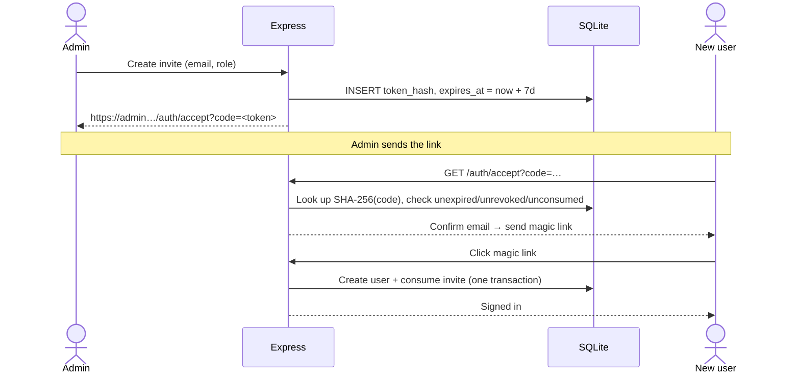
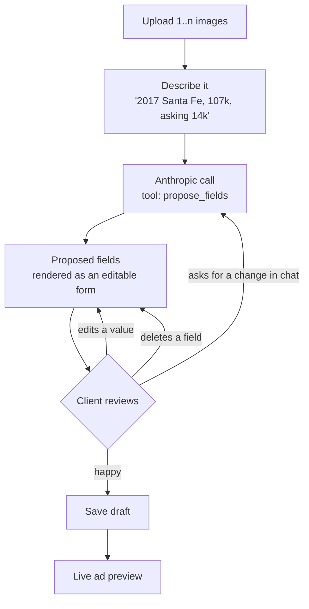
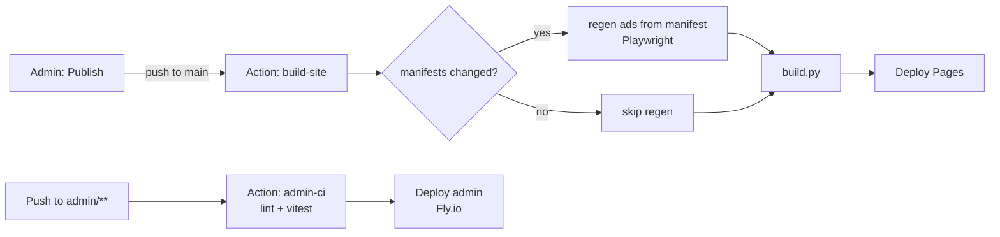

# Admin app — implementation plan

Status: **proposal, nothing built.** Written 18 Oct 2026.
Supersedes `ADMIN_PLATFORM_PLAN.md`.

A lean Express + Handlebars + Svelte admin that publishes into this repo and lets the
static site rebuild itself.

---

## 0. Three things to settle before any code

These came out of checking the repo, and each changes the design.

### 0.1 GitHub Pages cannot host the Node app

Pages serves static files only — it runs no processes. There is no configuration that
makes it execute Express. The admin needs ordinary application hosting.

This is not a problem, though, because you do not *want* them together. The storefront
should stay a CDN-backed static site: fast, free, and impossible to break from the
admin. The admin can be a small box that is occasionally down without a buyer noticing.

```
admin.yourdomain.com   →  Express app      (Fly.io / Render / $5 VPS)
yourdomain.com         →  GitHub Pages     (unchanged, static)
```

### 0.2 This repo is public — auth data cannot live in it

Verified: `visibility=PUBLIC`.

Committing users, invite tokens or sessions to this repo publishes them to the world.
A hashed invite token is still a token someone can grind offline; email addresses are
still PII. SQLite does not help — a committed `.db` file is just as readable, and worse,
git cannot merge a binary file, so two admins editing at once produces an unresolvable
conflict.

**So: split storage by what the data is.**

| Data | Where | Why |
|---|---|---|
| Products, services, pages, copy, prices | **JSON manifests, in this repo** | Content *should* be diffable, reviewable and revertable. This is the good part of repo-as-database. |
| Images | **In this repo** (`<env>/ads/`) | Already how the site works. |
| Users, invites, sessions | **SQLite on the app's own disk, outside git** | Secret, high-churn, and must never be public. |

This answers your SQLite question directly: **use both, split along that line.** Not one
or the other. If you later want the content in a database too, the manifest schema below
maps onto tables cleanly.

> If you would rather keep *everything* in the repo, the prerequisite is making it
> private — which also removes the public site from Pages' free tier for private repos.
> I would not do that. The split above costs you one small volume.

### 0.3 The ad generator is hardcoded and car-shaped

Two coupling problems that are the real work in this project:

**(a) `tools/gen_velocity.py` has a hardcoded `CARS` dict.** A client adding a product
through the admin changes nothing until that generator reads the manifest instead. This
refactor is a prerequisite for the whole feature, not a detail.

**(b) The Velocity ad template is car-specific.** It prints `KM`, `Engine`,
`Drivetrain` — fields that are meaningless for "Detailing" or "Winter tyre swap". Your
request treats Products and Services as the same thing; the ad layout does not.

Options, cheapest first:

1. **Generic spec slots.** Replace the three fixed columns with `spec1/spec2/spec3`
   (label + value). A car sets `165,000 / KM`; a service sets `2 hrs / Duration`. One
   template, minimal change. **Recommended.**
2. A second `service` template alongside `velocity`.
3. Services get no generated ad, only a page.

Everything below assumes option 1.

---

## 1. Architecture



The admin never serves public traffic. It writes files, commits, and pushes. GitHub
Actions does the rest — the pipeline you already have.

### Publish flow



---

## 2. Storage schema

### Layout

```
manifests/
  site.json                    nav order, which landings exist, global copy
  products/
    sienna.json
    santafe.json
  services/
    detailing.json
  landings/
    vehicles.json              a "Product or Service Landing"
    services.json
```

### `manifests/products/<slug>.json`

Every product asks for exactly the same fields — that is enforced by this schema, not by
asking the client nicely.

```jsonc
{
  "schema": 1,
  "slug": "santafe",
  "landing": "vehicles",           // which landing it belongs to
  "status": "published",           // draft | review | published | archived
  "order": 1,

  "title": "Hyundai Santa Fe Sport",
  "subtitle": "2.4L · Heated Seats",
  "year": "2017",
  "price": "14,000",
  "eyebrow": "Certified",          // the ad's corner tag

  "specs": [                        // exactly 3 render on the ad; more are page-only
    { "label": "KM",         "value": "107,000" },
    { "label": "Engine",     "value": "2.4L I4" },
    { "label": "Drivetrain", "value": "FWD/AWD" }
  ],

  "body": "Optional long copy for the page.",

  "images": [
    { "file": "santafe_a.jpg", "role": "primary" },
    { "file": "santafe_b.jpg", "role": "secondary" }
  ],

  "generated": {                    // written by the build, not by hand
    "formats": ["social", "phone", "landscape"],
    "rendered_at": "2026-10-18T13:40:00Z"
  },

  "audit": {
    "created_by": "fred@…", "created_at": "…",
    "updated_by": "client@…", "updated_at": "…",
    "published_at": "…"
  }
}
```

Services use the identical shape with `"kind": "service"` and different spec labels.
One schema, one editor, one renderer.

### `manifests/landings/<slug>.json`

```jsonc
{
  "schema": 1,
  "slug": "vehicles",
  "status": "published",
  "nav_label": "Vehicles",         // becomes the header menu item
  "nav_order": 1,
  "heading": "The Lineup",
  "lede": "Pre-owned vehicles for Ottawa drivers, priced to move…",
  "kind": "product"                // product | service
}
```

Adding a landing writes one of these; `build.py` then generates
`/<slug>/index.html` plus `/<slug>/cars/*.html` using the templates it already has, and
the header picks up the nav item. **The parent/child structure you have today becomes
the generic case rather than a special case for the root.**

### Validation

Every write is validated with **Zod** before it touches disk. A manifest that fails
schema never gets written, so the static build cannot be handed malformed input.

### SQLite (outside the repo)

```sql
users    (id, email, name, role, created_at, last_login_at)
invites  (id, token_hash, email, role, created_by, expires_at, revoked_at, consumed_at)
sessions (sid, sess, expire)          -- connect-sqlite3
```

Three tables. No ORM — `better-sqlite3` with handwritten SQL is less code than a
migration framework at this size.

---

## 3. State machine



Rules worth stating:
- **Drafts never reach GitHub.** They live in the clone only. Nothing half-finished can
  appear on the public site, and the client cannot accidentally publish by saving.
- `published → draft` keeps the live version serving until the new draft is published.
- `archived` removes pages and images from the site but keeps the manifest, so "we sold
  it, then it came back" is one click rather than a re-entry.
- Only `publish`, `archive` and `restore` produce commits. Everything else is local.

If you do not want a `review` step with a single client user, collapse it —
`draft → published` is fine and I would probably start there.

---

## 4. Auth

Passport, invite-only, passwordless. Two viable mechanisms:

| | Magic link | Passkeys |
|---|---|---|
| Library | `passport-magic-link` | `@simplewebauthn/server` + thin custom strategy |
| Needs | An email provider (Resend/Postmark) | A custom domain |
| Client UX | Enter email → click link in inbox | Touch ID / Face ID |
| Lost device | Fine — new link | Locked out without a second passkey |

**Recommendation: magic link.** It is dramatically less code, needs no custom domain to
work correctly, and for a non-technical client "click the link in your email" beats
explaining passkeys. Add passkeys later as a second factor if it ever matters.

### Invite flow



- 32 random bytes, base64url; **only the hash is stored**
- 7-day expiry as specified; `revoked_at` set by a Revoke button; both checked on redeem
- The code field is prefilled from `?code=` and manually enterable as a fallback
- `Referrer-Policy: no-referrer` on `/auth/*` — tokens in URLs leak via referrer headers
- Rate-limit redemption with `express-rate-limit`
- **First admin** cannot be invited: `npm run admin:create -- fred@…`, needs shell access

---

## 5. The editor and the chat

This is the feature the client actually touches, so it deserves the most care.



**The model never writes files or free text into the ad.** It is given one tool,
`propose_fields`, whose arguments are the manifest schema. Its output is validated with
the same Zod schema as a manual edit and rejected on failure. So the worst a bad
response can do is propose wrong values into a form the client is already reviewing.

The preview renders the real ad from the real generator, not an approximation — the
client sees what will ship.

Implementation notes:
- The editor is a **Svelte island** mounted into a Handlebars page. Chat, field list and
  preview are reactive; everything else on the site is server-rendered.
- Stream responses (`@anthropic-ai/sdk`) so the chat feels alive.
- Cap spend: max tokens per call, max calls per draft, a monthly ceiling.
- The API key lives in the app's env. It is never sent to the browser.

---

## 6. Bootstrap admin themes

All MIT-licensed and Bootstrap 5.

| Theme | Notes |
|---|---|
| **Tabler** | Cleanest, most modern, excellent components. Heavier. **My pick.** |
| **AdminLTE 4** | The most widely used; huge component set; looks a touch dated. |
| **CoreUI Free** | Middle ground; tidy; smaller community. |
| **SB Admin 2** | Minimal and easy to understand. Dated styling, but little to fight. |
| **Volt** | Good-looking, Bootstrap 5, fewer components. |

**Recommendation: Tabler**, with the caveat that for *this* app you need roughly six
screens. Any of them works; pick on looks and move on. Do not spend a week evaluating
dashboards for an admin with one user.

Keep the admin on Bootstrap and leave the public site's bespoke Velocity CSS alone. They
are different products with different jobs.

---

## 7. Libraries

| Concern | Choice | Why |
|---|---|---|
| Server | `express` 5 | As asked; stable, boring |
| Views | `express-handlebars` | As asked |
| Islands | `svelte` 5 + `vite` | Editor/chat only |
| Auth | `passport` + `passport-magic-link` | As asked |
| Sessions | `express-session` + `connect-sqlite3` | No extra service |
| DB | `better-sqlite3` | Synchronous, fast, zero-config |
| Validation | `zod` | One schema for API, manifest and AI output |
| Git | `simple-git` | Commit/push from Node |
| Uploads | `multer` + `sharp` | Resize/strip EXIF on ingest |
| AI | `@anthropic-ai/sdk` | Tool-use + streaming |
| Security | `helmet`, `express-rate-limit`, `csurf` | Baseline |
| Email | `resend` | Magic links |
| Logs | `pino` | Structured, cheap |
| Tests | `vitest` + `supertest` | Fast |

No TypeScript is a defensible call for leanness, but **I would use it** — the manifest
schema is the heart of this system and types keep the admin, the build and the AI output
agreeing. `zod` gives you the types for free from schemas you need anyway.

---

## 8. Repo layout

```
/                       existing static site (unchanged)
  build.py              extended: reads manifests/, generates landings
  tools/                extended: gen_velocity reads manifests/
  manifests/            NEW — content, committed
  admin/                NEW — the Express app
    src/
      routes/           auth, products, services, landings, settings
      services/         manifest-io, publisher, git, anthropic
      islands/          Svelte: editor, chat, preview
      views/            Handlebars + Tabler
    data/               SQLite — gitignored, on a volume
    test/
```

One repo, two deployables. The admin is ignored by the Pages build; `build.py` never
looks inside `admin/`.

---

## 9. ALM / automation



- **Path filters** so an admin code change does not re-render 15 ads, and a manifest
  change does not redeploy the admin.
- **Ad regeneration moves into CI.** The Action runs `tools/regen.sh` when a manifest
  changes, so the admin host needs no Python or Chromium — it only writes JSON and
  images. This keeps the Node app genuinely lean and is why the `regen.sh` work already
  done matters here.
- Cache the Playwright browser in Actions or every publish pays ~45s.
- Environments stay as they are: publish targets `development/` first, and promotion
  between environments is a button that copies manifests across.

---

## 10. Phasing

| Phase | Scope | Effort |
|---|---|---|
| **0** | Refactor `gen_velocity.py` to read manifests; generate today's 5 cars from JSON with byte-identical output | 3–4 days |
| **1** | `build.py` generates landings from `manifests/landings/` | 2–3 days |
| **2** | Express skeleton, Tabler, magic-link auth, invites, SQLite | 1 week |
| **3** | Product CRUD, image upload, manifest write, draft state | 1 week |
| **4** | Publish: git commit/push + Action wiring + state machine | 4–5 days |
| **5** | AI chat field extraction + live preview | 1 week |
| **6** | Landings CRUD, nav ordering, site settings | 4–5 days |

**Roughly 5–6 weeks.** Phase 0 is the one people skip and regret: until the generator
reads manifests, nothing the admin writes affects the site.

Usable at the end of Phase 4. Phase 5 is the differentiator but not the foundation.

---

## 11. Pushback

Ordered by how much I think they matter.

1. **The generator refactor is the project.** The admin UI is a few weeks of
   well-trodden CRUD. Making a hardcoded, car-shaped Python renderer take arbitrary
   manifest-driven products is where the risk sits. Budget accordingly.

2. **"Products and Services are the same thing" is not true at the ad layer.** The ad
   prints KM/Engine/Drivetrain. Generic spec slots (§0.3) fix it cheaply, but someone
   has to decide that services get an ad at all.

3. **Repo-as-database works here, and only here.** One or two users, low write volume,
   content that benefits from diffs. It breaks on concurrent edits — two admins
   publishing at once is a push conflict. Mitigate with a single-writer lock and
   pull-before-write, and know the ceiling exists.

4. **~60s from Publish to live.** Clicking Publish and seeing nothing for a minute reads
   as broken to a non-technical user. The UI must show the Action's progress, not just a
   success toast.

5. **The chat may be the wrong tool for the job.** For a fixed-schema form with eight
   fields, a client may well find typing into eight boxes faster than describing a car in
   prose and correcting what comes back. Where it clearly wins is bulk entry — paste a
   Kijiji description, get fields. Worth building Phase 3's plain form first and
   confirming the chat earns its place.

6. **No image deletion safety.** The client removing the only photo of a published
   product breaks its ad. Enforce "a published product has ≥1 image" in the schema.
