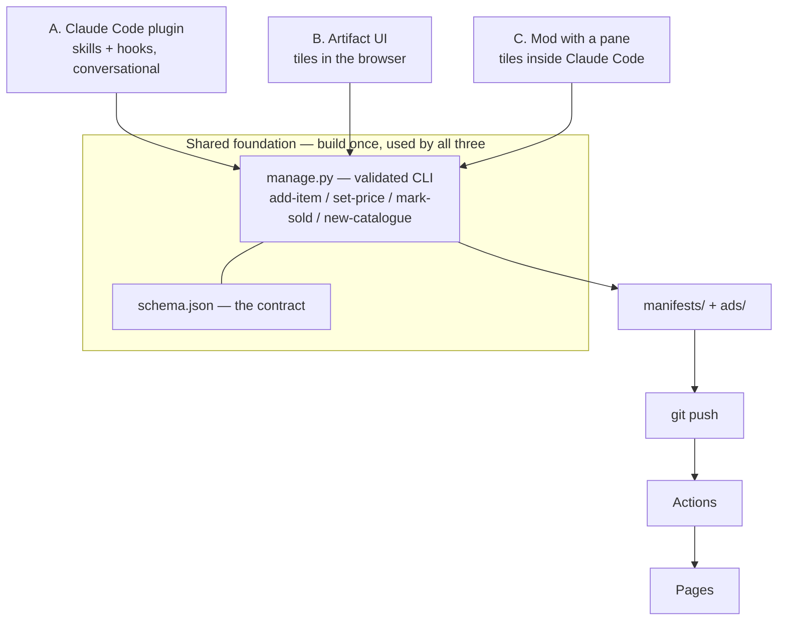
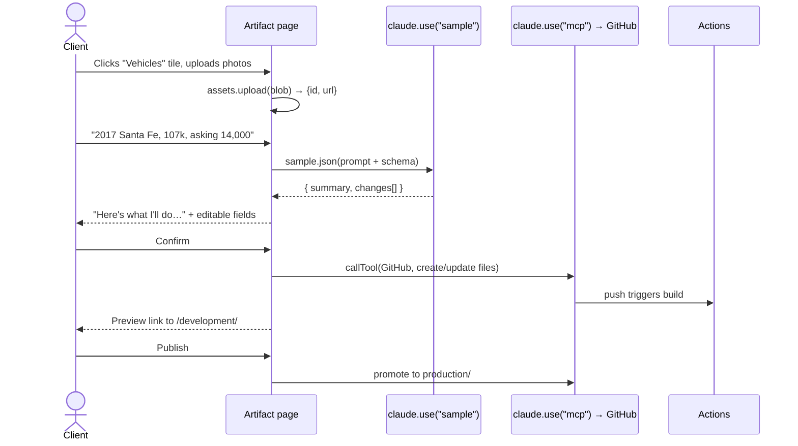

# Agent-driven admin — implementation plan

Status: **proposal, nothing built.** Written 18 Oct 2026.
Alternative to `ADMIN_APP_PLAN.md` (Express) and `ADMIN_PLATFORM_PLAN.md` (Next.js, superseded).

Two shapes for the same idea: let the model do the work, and skip building an app.

---

## 1. Your question answered first

> *Can the tailored UI be built directly as a Claude Code app, or in the browser via
> Claude itself, so there's no hosting?*

**Yes, both — and I checked the current specs rather than guessing.**

| Surface | Verdict |
|---|---|
| **Claude Artifact** (browser) | A published page can call Claude itself via the `sample` capability, take image uploads via `assets`, keep drafts in `db`, and reach GitHub through the viewer's own connector via `mcp`. No hosting, no server, no credential in the page. |
| **Claude Code mod** (pane) | A plugin can open a real pane (`$.ui.open` + a `ui.render` hook on `Pane`) and draw tiles, buttons and forms in the desktop app. Also slash commands, toasts, and `tool.call` hooks. |

So a lean Node or Flask app is the **fallback**, not the baseline. That reverses what I
told you two turns ago, and it is the single most useful thing in this document.

---

## 2. The three shapes



**The foundation is the point.** Whichever surface wins, `manage.py` underneath is the
same. Pick wrong and you have rewritten a UI, not a system. This is what makes the whole
decision low-risk, and it is why Phase 0 is first in every variant.

---

## 3. Option A — Claude Code plugin

The unorthodox one. The operator talks; the agent edits the repo.

**What it contains**

```
autoline-admin/
  .claude-plugin/plugin.json
  skills/
    add-vehicle/SKILL.md        "add a car" → asks for photos + details → manage.py
    update-listing/SKILL.md     price, mileage, copy changes
    mark-sold/SKILL.md          removes from site, keeps the manifest
    new-catalogue/SKILL.md      adds a menu item + landing
  hooks/
    hooks.json
    register.tsx                the hard guardrail
  CLAUDE.md                     scope: this repo, these paths, nothing else
```

**Guardrails — the part that matters.** A `CLAUDE.md` saying "only touch these files" is
*instruction*. A `tool.call` hook is *enforcement*:

```
on('tool.call', { tool: 'Write' }, ($, e, next) =>
  allowed(e.input.file_path) ? next(e) : { deny: 'outside manifests/ and ads/' })
```

Combined with branch protection so the agent opens a PR rather than pushing to `main`,
the worst case is a PR you decline. Add `$.ui.toast` on publish and a status line entry
showing the last build result and it stops feeling like a shell.

**Honest limits**

- Needs Claude Code installed and git credentials configured. Fine for you, a steep ask
  for a non-technical client.
- Output varies in phrasing. `manage.py` validation is what makes that not matter —
  never let the agent hand-edit JSON.
- Every edit costs tokens. Trivial at this volume; not free the way a form is.

**Effort: ~1 week** on top of Phase 0.

---

## 4. Option B — tiles as an Artifact (no hosting)

Your "friendlier front end" idea, in the browser, with nothing to deploy.



**Capabilities it declares**

| Capability | Used for |
|---|---|
| `sample` | The page asks Claude itself. `sample.json` returns a **plan object**, not prose — that's what makes the confirm-before-apply step reliable. `tools:[…]` lets the model call page functions. |
| `assets` | Photo upload, 20 MiB per file, returns a public-ish URL and an id. |
| `db` | Drafts, per-item state, the tile counts. Survives republishes. |
| `mcp` | Calls GitHub **as the viewer, using their credentials — no token in the page.** |
| `user` | Who's viewing; `isOwner()` / `canEdit()` to gate publish. |

**The confirm-then-preview flow you described maps directly onto `sample.json`:** ask for
`{ summary: string, changes: [{file, action, before, after}] }`, render that for
approval, and only call `mcp` once the user clicks. The model proposes; the page
executes; the user decides in between.

### Prerequisites — read these before getting attached

1. **A GitHub connector must be authorized on claude.ai.** This session shows Claude
   Docs, Microsoft 365, visualize and Lucid connected — **GitHub is not.** The
   `engineering:github` connector exists but needs authorizing. Without it the page can
   render and call Claude but cannot write to the repo. This is the one hard blocker.
2. **Declaring `mcp` bars public link sharing.** Fine — this is invite-only by nature.
3. **The client needs a Claude account**, in your organization or as an invited guest.
   You share the artifact from its Share menu; I can't do that for you.
4. **`sample` is memoryless.** Every call ships instructions + data + format. Fine, but
   it shapes how you write the prompts.

**Effort: ~1.5 weeks** on top of Phase 0, assuming the connector is authorized.

---

## 5. Option C — tiles as a Claude Code pane

Same tiles, drawn inside Claude Code rather than the browser.

```
on('ui.render', { component: 'Pane', requestId: 'autoline' }, ($, e) => {
  const { Box, Text, Button } = $.ui.resolve(e)
  return <Box>…tiles…</Box>
})
```

Opened with `$.ui.open({ id: 'autoline', title: 'Autoline' })`, registered as a slash
command, drawn by whichever surface is attached — `terminal`, `desktop`, `vscode` or
`mobile`.

**Worth it when** you want the tiles *and* the conversation in one place, and the
operator is already in Claude Code. **Not worth it** as the client-facing answer: it
still needs Claude Code installed, so it carries Option A's adoption problem with more
work than Option A.

I'd treat C as a later upgrade to A, not a separate track.

**Effort: ~1 week** on top of A.

---

## 6. Comparison

| | A — Plugin | B — Artifact | C — Pane | D — Web app |
|---|---|---|---|---|
| Hosting | none | none | none | Azure F1 |
| Auth to build | none (git is the gate) | none (Claude account is the gate) | none | magic link + sessions |
| Non-technical client | poor | **good** | poor | good |
| Phone access | no | **yes** | no | yes |
| Hard guardrails | `tool.call` hooks | page controls the calls | hooks | code |
| Determinism | via `manage.py` | via `manage.py` | via `manage.py` | total |
| Blocker | — | **GitHub connector** | — | — |
| Effort after Phase 0 | ~1 wk | ~1.5 wk | ~2 wk | ~4 wk |

---

## 7. Recommendation

**Phase 0 first, then A, then B if the client actually wants self-service.**

Phase 0 — `manage.py` plus the generator refactor — is unavoidable in every option and
is most of the real work. It is also the thing that makes the UI choice reversible.

Then Option A, because it is a week, it serves *you* immediately, and it tells you which
operations actually recur. Build B knowing that, rather than guessing which tiles matter.

**The one thing I'd change about your framing:** the emailed invite code isn't an auth
mechanism. In A the gate is repo write access; in B it's who you share the artifact with.
Both are real and both are better than anything I'd hand-roll — just don't count on the
code itself to keep anyone out.

**And skip the S3 bucket.** 27 MB of images against GitHub's 1 GB soft limit. It adds an
account, a credential and a bill to solve a problem you won't have for years, and it
breaks the property that the repo is the single source of truth.

---

## 8. Phasing

| Phase | Scope | Effort |
|---|---|---|
| **0a** | `schema.json` + `manage.py` with validation | 3 days |
| **0b** | `gen_velocity.py` reads manifests; byte-identical output for today's 5 cars | 3–4 days |
| **0c** | `build.py` generates a landing per catalogue | 3 days |
| **A** | Plugin: 4 skills, guardrail hook, scoped CLAUDE.md | 1 week |
| **B** | Artifact: tiles, `sample` plan/confirm, `assets` upload, `mcp` publish | 1.5 weeks |
| **C** | Pane for the tiles inside Claude Code | 1 week |

Usable after 0 + A: **~2.5 weeks**, no hosting, no auth system, no server.

---

## 9. Risks

1. **The GitHub connector gates Option B entirely.** Authorize it before committing to B.
2. **`manage.py` is the whole bet.** If its validation is weak, every option inherits the
   weakness. Write its tests first.
3. **Agent-driven editing has no undo button** beyond git. Branch protection and
   PR-only writes turn that from a risk into a review step.
4. **Artifact capabilities are a current contract** (0.2.85 as of writing). They are
   stable enough to build on, but pin the contract version deliberately rather than
   drifting with `latest`.
5. **A services catalogue still strains the car-shaped ad.** Unchanged from the other
   plans; decide before Phase 0c.
