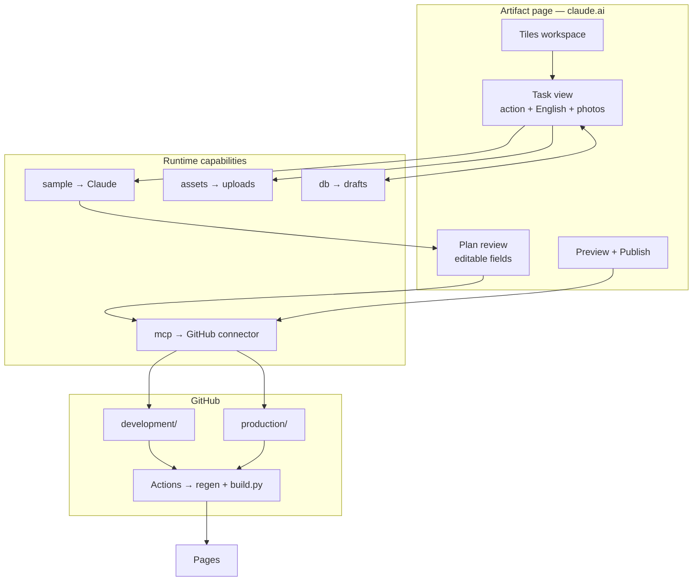
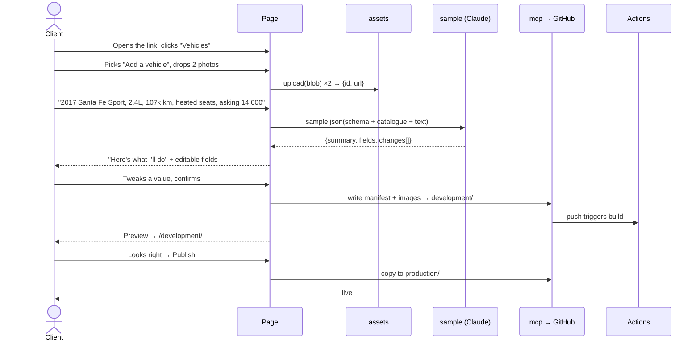

# Option B — the admin as a published Artifact

Status: **design for review, nothing built.** Written 18 Oct 2026.

A tiles UI that runs as a Claude Artifact: no server, no hosting, no auth system, no
credential in the page. The page asks Claude what to do, shows you the plan, and only
writes to the repo once you approve.

Mockup: `docs/prototype/b-workspace.html` (clickable: workspace -> task -> plan ->
applying -> preview -> published).
Companion: [`AGENT_ADMIN_PLAN.md`](AGENT_ADMIN_PLAN.md) for how this compares to the
plugin and web-app routes.

---

## 1. What makes this possible

A published Artifact can declare **runtime capabilities** — things the claude.ai viewer
grants the page when someone opens it. Five of them carry this design:

| Capability | What it gives the page | Role here |
|---|---|---|
| `sample` | Calls Claude from the page. `sample.json` returns a parsed value, not prose. | Turns English into a structured change plan |
| `assets` | Uploads (20 MiB/file), returns `{id, url}` | Photo intake and preview |
| `db` | Documents outside the page, live, survives republish | Drafts, tile counts, publish history |
| `mcp` | Calls the viewer's connectors **with their credentials — no token in the page** | Writes to GitHub |
| `user` | Who is viewing; `isOwner()`, `canEdit()` | Gates Publish |

The last one is the crux: **the page never holds a GitHub token.** It asks the viewer's
own connector to act, and the viewer consents. That is why this needs no auth system —
access is "can you open this artifact, and is your connector attached", both of which
claude.ai already answers.

---

## 2. Architecture



**The model proposes; the page executes; the user decides in between.** Claude is never
given the ability to call GitHub. It returns a plan object; the page renders it; only a
click turns it into a write. That is the whole safety story, and it is why the
non-determinism that worries people about agents does not apply here.

---

## 3. The flow



**Two-stage publish is deliberate.** Writing to `development/` first means the client
sees the real rendered ad on the real site before anything reaches buyers. It costs one
extra click and removes the entire class of "it looked fine in the preview" problems.

---

## 4. What Claude is asked for

Not prose. A plan object, validated before anything renders:

```js
const plan = await sample.json(
  `You turn a description into a catalogue item.
   Catalogue: ${cat.nav_label}. Spec slots: ${cat.spec_defaults.map(s => s.label)}.
   Return JSON matching this shape exactly: ${SCHEMA}
   Leave a field null if the description does not state it — never invent a value.
   Description: ${userText}`
)
```

Returning:

```jsonc
{
  "summary": "Add a 2017 Hyundai Santa Fe Sport at $14,000 to Vehicles.",
  "fields": {
    "title": "Hyundai Santa Fe Sport",
    "subtitle": "2.4L · Heated Seats",
    "year": "2017",
    "price": "14,000",
    "eyebrow": null,
    "specs": [
      { "label": "KM",         "value": "107,000" },
      { "label": "Engine",     "value": "2.4L I4" },
      { "label": "Drivetrain", "value": null }
    ]
  },
  "changes": [
    { "file": "manifests/items/vehicles/santafe.json", "action": "create" },
    { "file": "development/ads/jpg/santafe_a.jpg",     "action": "create" }
  ]
}
```

Three properties worth keeping:

1. **`null` means "not stated".** The field renders empty and flagged, so the client
   fills it rather than the model inventing something plausible. On a commercial listing
   an invented mileage is worse than a blank one.
2. **`changes[]` is shown before it happens.** The client sees which files move.
3. **Every field stays editable.** The model's output is a first draft in a form, never
   a commit.

`sample` is memoryless — each call carries the schema and the catalogue. That is a
feature here: no hidden conversational state means the same input gives the same plan.

---

## 5. Screens

| Screen | Mockup | Purpose |
|---|---|---|
| Workspace | `b-workspace.html` | Tiles: catalogues, settings, activity. Counts from `db`. |
| Task | `b-task.html` | Pick an action, upload photos, describe in English |
| Plan | `b-plan.html` | Claude's summary + editable fields + file list → Confirm |
| Applying | `b-applying.html` | Real Actions progress, not a fake spinner |
| Preview | `b-preview.html` | The live `development/` page, then Publish |
| Published | `b-published.html` | Done, with a link |

Actions offered per tile are fixed, not free-form: *Add an item · Change a price ·
Update photos · Mark as sold · Edit landing copy*. The English box sits **inside** a
chosen action, so the model is never asked "what does the user want?" — only "fill this
schema from this description".

---

## 6. Open questions — things I will not guess at

### 6.1 The connector's display name and tools **(blocking)**

The `mcp` declaration names a connector by its **display name**, and lists the exact
upstream tool names the page calls:

```js
capabilities: {
  mcp: { servers: [{ server: "<exact display name>", tools: ["<exact>", "…"] }] }
}
```

You say GitHub is connected; my tooling in this session does not see it, which may just
mean this session's view differs from claude.ai's. Either way I need from you:

- the connector's display name, exactly as claude.ai shows it
- the tool names it exposes for reading and writing repository files

Guessing these ships a page that fails at the last step, so this is the one input I need
before writing code.

### 6.2 Getting image bytes into the repo **(the main technical risk)**

Photos land in the browser; they must end up in `<env>/ads/jpg/`. Three routes:

1. **Base64 through the connector's file-write tool.** Most likely correct. Depends on
   that tool's payload ceiling — current ads are 300 KB–3 MB, which base64 inflates by
   ~33%. Needs testing against the real tool.
2. **Upload to `assets`, let CI fetch the URL.** Cleaner for large files, but asset URLs
   serve from the artifact origin and are unlikely to be reachable from a GitHub runner.
   Probably a dead end.
3. **Resize in-page before sending.** `canvas.toBlob()` down to ~1200px before base64.
   Reduces the problem and is worth doing regardless, since the ad generator composites
   its own output anyway.

**Plan: 3 plus 1, verified with one real upload before building the rest.**

### 6.3 Sharing and access

- Declaring `mcp` **bars public link sharing**. Correct for an invite-only admin, but it
  means the client must be in your organization or an invited guest.
- You share the artifact from its Share menu — I cannot do that for you.
- `user.canEdit()` gates Publish, so a viewer-level account could look without shipping.

---

## 7. Risks

1. **The connector is the single point of failure.** If it is unavailable at view time,
   `claude.use("mcp")` resolves `null` and the page cannot publish. It must render
   read-only and say so rather than appearing broken.
2. **Consent prompts on first use.** `sample` and `mcp` ask the viewer the first time.
   Trigger them from a click, never on load, or the client meets a dialog before they
   understand the page.
3. **Image payload ceiling** — §6.2.
4. **Contract version.** Capabilities run against a runtime contract (0.2.85 at writing).
   Pin it deliberately; do not drift with `latest`.
5. **Rate limits.** `sample` can return `rate_limited`. Back off, never loop.
6. **This still needs Phase 0.** `manage.py` and the manifest schema are what the plan
   object validates against. Without them the page has no contract to fill.

---

## 8. Phasing

| Phase | Scope | Effort |
|---|---|---|
| **0** | `schema.json` + `manage.py`; generator reads manifests | 1.5 weeks |
| **B1** | Artifact shell: tiles, `db` state, `user` gating | 3 days |
| **B2** | Task view + `assets` upload + in-page resize | 3 days |
| **B3** | `sample` plan/confirm loop with editable fields | 4 days |
| **B4** | `mcp` writes to `development/`, Actions progress | 4 days |
| **B5** | Preview + promote to `production/` | 2 days |

**~3.5 weeks**, of which Phase 0 is nearly half and is shared with every other option.

Spike B4 first with one hardcoded file write. It is the step with the unknowns, and
proving it early means the rest is ordinary UI work.

---

## 9. Why this over the alternatives

- **vs. the Express app** — no hosting, no auth, no server, no cold starts, ~1.5 weeks
  less work, and the client opens a link on their phone.
- **vs. the Claude Code plugin** — your non-technical client does not install a
  developer tool or configure git.
- **The cost** — you depend on the connector and the capability contract, and a tiles
  page is less flexible than a conversation. Both acceptable for a fixed, small set of
  operations, which is exactly what this is.
